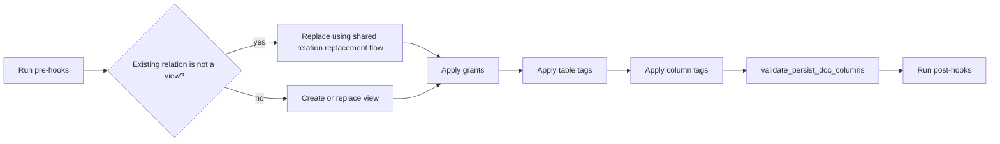
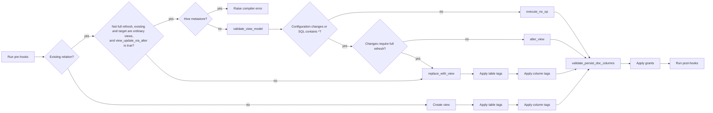

# View Flow

_Last updated: 2026-10-23_

> Two diagrams follow: **V1** is the default path, **V2** is used when the `use_materialization_v2`
> behavior flag is enabled. See [flow/README.md](README.md) for what the flag is and how the
> selection works. Source: `dbt/include/databricks/macros/materializations/view.sql`.

## V1 View Flow

V1 and V2 both call the shared `run_pre_hooks` / `run_post_hooks` helpers; see [hook transaction
categories](README.md#hook-transaction-categories). For a different existing relation type, V1
uses the shared [replace flow](replace_flow.md).

## V2 View Flow

Replacement branches use the shared [replace flow](replace_flow.md).

`relation_should_be_altered` rejects the Hive metastore when alter-in-place was requested.
`validate_view_model` is the same check `create_view_as` runs: it rejects column masks and row
filters and asserts an enforced contract, so ALTER and no-op runs fail where CREATE would. A
replacement applies table and column tags after `get_replace_sql`; an in-place alter applies the
configuration changes returned by relation configuration comparison.

When `view_update_via_alter` is enabled, SQL containing `*` is reapplied even when its text is
unchanged, so wildcard views pick up upstream column additions. The check uses the compiled SQL
already available to dbt and adds no schema-inference or metadata query. It conservatively
includes `COUNT(*)`, multiplication, and stars in comments or string literals. SQL without `*`
keeps the existing query and configuration comparison, including the no-op path when nothing
changes; upstream type changes alone do not trigger a query update for those explicit projections.
Column-comment-only changes retain their own diff path, and query updates use the existing
column-comment reapplication after `ALTER VIEW AS`.

Both paths then run
`validate_persist_doc_columns`, which warns when documented columns are missing from the built
relation.
