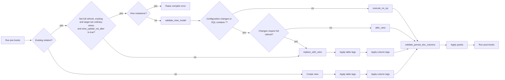

# View Flow

_Last updated: 2026-10-26_

> Views run one flow; the `use_materialization_v2` behavior flag does not change it. See
> [flow/README.md](README.md) for the flag. Source:
> `dbt/include/databricks/macros/materializations/view.sql`.

Pre-hooks and post-hooks use the shared `run_pre_hooks` / `run_post_hooks` helpers; see [hook
transaction categories](README.md#hook-transaction-categories). Replacement branches use the shared
[replace flow](replace_flow.md).

`relation_should_be_altered` rejects the Hive metastore when alter-in-place was requested.
`validate_view_model` is the same check `create_view_as` runs: it rejects column masks and row
filters and asserts an enforced contract, so ALTER and no-op runs fail where CREATE would. Under
`dbt clone` the view selects from the deferred relation rather than the current model, so the
contract is not asserted. Materialized views and streaming tables also clone as views; for them
the mask and row-filter rejection is skipped too, because the deferred object enforces its own
policies (whatever production has, not the current config, including when the branch changed
the model's materialization). Plain view models still reject masks and row filters under clone. A replacement applies table and column tags after
`get_replace_sql`; an in-place alter applies the configuration changes returned by relation
configuration comparison.

When `view_update_via_alter` is enabled, SQL containing `*` is reapplied even when its text is
unchanged, so wildcard views pick up upstream column additions. The check uses the compiled SQL
already available to dbt and adds no schema-inference or metadata query. It conservatively
includes `COUNT(*)`, multiplication, and stars in comments or string literals. SQL without `*`
keeps the existing query and configuration comparison, including the no-op path when nothing
changes; upstream type changes alone do not trigger a query update for those explicit projections.
Column-comment-only changes retain their own diff path. Query updates skip that diff and instead
reapply documented comments to the columns read after `ALTER VIEW AS`, regardless of an inherited
`file_format`, so a comment change on a column the new query removed is not applied.

CREATE and view-to-view replacement both build the view through `get_create_view_as_sql`, so
overrides of it or of `create_view_as` apply to either. Every branch then runs
`validate_persist_doc_columns`, which warns when documented columns are missing from the built
relation, before grants and post-hooks.
